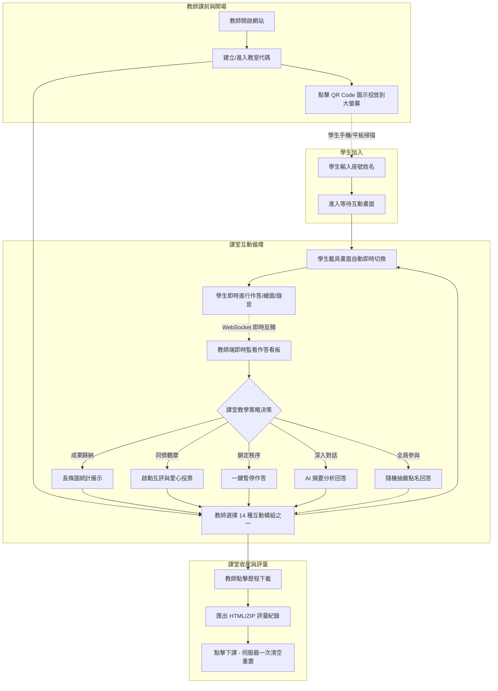

# 剛好學：課堂互動 so easy — Cloudflare 版

這一版不再使用 Firebase，網站和資料庫都放在 **Cloudflare 免費方案**上：

- **網站**：Cloudflare Workers（靜態網頁）
- **資料庫**：Cloudflare Durable Objects 內建的 SQLite 資料庫（每間教室一個資料庫）
- **即時同步**：WebSocket，老師和學生的畫面會即時更新

老師和學生都**不用再貼任何設定**，打開網址就能用。

---

## 一、資料夾內容

```
剛好學-cloudflare版/
├─ public/
│   ├─ index.html      ← 主程式（由 01classtools.html 改寫而來）
│   └─ cfdb.js         ← 資料存取程式（取代 Firebase）
├─ src/
│   └─ worker.js       ← 後端程式（資料庫與即時同步）
├─ wrangler.jsonc      ← Cloudflare 部署設定檔
├─ 01classtools.html   ← 原本的 Firebase 版（僅保留備份，不會上傳）
└─ README.md           ← 本說明檔
```

> ⚠️ `public/index.html` **不能直接雙擊打開使用**，一定要部署到 Cloudflare（或用第五節的方法在本機測試），因為它需要後端資料庫。

---

## 二、事前準備（只需做一次）

### 1. 註冊 Cloudflare 帳號

1. 打開 <https://dash.cloudflare.com/sign-up>
2. 輸入 Email 和密碼註冊，並到信箱點驗證信。
3. **不需要綁定信用卡**，免費方案就能使用本程式的所有功能。

### 2. 安裝 Node.js

部署工具 Wrangler 需要 Node.js。

1. 打開 <https://nodejs.org/>
2. 下載左邊的 **LTS（長期支援版）**，一路按「下一步」安裝完成。
3. 確認安裝成功：按 `Win` 鍵，輸入 `cmd` 打開「命令提示字元」，輸入：

   ```
   node -v
   ```

   出現像 `v22.x.x` 的版本號就代表成功。

---

## 三、部署到 Cloudflare（用指令，最推薦）

### 步驟 1：在本資料夾打開命令視窗

1. 用檔案總管打開 `剛好學-cloudflare版` 資料夾（看得到 `wrangler.jsonc` 那一層）。
2. 點一下上方的**網址列**，把內容改成 `cmd` 後按 Enter，就會在這個資料夾開啟命令提示字元。

### 步驟 2：登入 Cloudflare

輸入：

```
npx wrangler login
```

- 第一次執行會問 `Need to install the following packages ... Ok to proceed? (y)`，輸入 `y` 按 Enter。
- 瀏覽器會自動打開 Cloudflare 授權頁面，按 **Allow（允許）**。
- 看到 `Successfully logged in` 就完成了，可以關掉該網頁。

### 步驟 3：部署

輸入：

```
npx wrangler deploy
```

- 如果是第一次使用 Cloudflare Workers，會請你設定一個 **workers.dev 子網域**（例如輸入 `mrchang`），這會成為網址的一部分，之後不能隨意更改，請取一個好記的英文名稱。
- 完成後會顯示網址，例如：

  ```
  https://classtools.mrchang.workers.dev
  ```

**這就是你的剛好學網址！** 老師和學生都用這個網址進入。

> 💡 網址前半段 `classtools` 來自 `wrangler.jsonc` 裡的 `"name"`，想改名可以在部署前修改這一行（只能用英文小寫、數字和 `-`）。

### 步驟 4：資料庫設定？——已經自動完成了！

`wrangler.jsonc` 已經寫好資料庫設定，`npx wrangler deploy` 時 Cloudflare 會**自動建立**資料庫，不需要另外到後台建立或貼任何設定。

想確認的話：

1. 登入 <https://dash.cloudflare.com/>
2. 左側選單點 **Workers & Pages**（運算 → Workers & Pages）
3. 點進 `classtools`，在「繫結 / Bindings」區域會看到名為 `ROOMS` 的 **Durable Object**，這就是資料庫。
4. 每開一間教室，就會自動產生一個該教室專用的資料庫；按下「下課」時會清空該教室的資料。

---

## 四、另一種部署方式：透過 GitHub（不想打指令的話）

1. 到 <https://github.com/> 註冊帳號，按右上角 **＋ → New repository** 建立一個新儲存庫（可設為 Private）。
2. 在儲存庫頁面點 **uploading an existing file**，把 `public` 資料夾、`src` 資料夾、`wrangler.jsonc` 拖曳上傳（`01classtools.html` 不用上傳），按 **Commit changes**。
3. 到 Cloudflare 後台 → **Workers & Pages** → **建立應用程式（Create application）** → 選 **匯入存放庫（Import a repository）** → 連結 GitHub 帳號並選擇剛剛的儲存庫。
4. 部署設定保持預設（部署指令為 `npx wrangler deploy`），按 **部署（Deploy）**。
5. 完成後，在該 Worker 的頁面可以看到網址。之後只要在 GitHub 上更新檔案，Cloudflare 會自動重新部署。

---

## 五、在自己電腦上先測試（可選）

在本資料夾的命令視窗輸入：

```
npx wrangler dev
```

看到 `Ready on http://127.0.0.1:8787` 後，用瀏覽器打開 <http://127.0.0.1:8787> 即可測試。
可以再開一個「無痕視窗」當學生端。按 `Ctrl + C` 結束測試。

---

## 六、之後修改程式要怎麼更新？

修改 `public/index.html` 後，在本資料夾的命令視窗再執行一次：

```
npx wrangler deploy
```

幾秒後網站就會更新，原本的教室資料不會遺失。

---

## 七、和 Firebase 版的差異

| 項目 | Firebase 版 | Cloudflare 版 |
|---|---|---|
| 設定 | 要貼 Firebase 設定、產生「異機專用網址」 | **免設定**，網址直接分享給學生 |
| 右上角「Firebase 設定」按鈕 | 有 | 已移除 |
| 學生加入網址 / QR Code | 網址夾帶 Firebase 設定（很長） | 就是網站網址（短、乾淨） |
| 學生在線判斷 | 學生每 30 秒寫入一次心跳 | 依連線狀態判斷：學生關閉分頁或斷網時自動從在線名單移除 |
| 下課清除資料 | 逐筆讀出再逐筆刪除 | 伺服器端一次清空 |

使用者 ID 改存在瀏覽器的 localStorage（重新整理不會變），按「下課」後會換發新 ID，與原本的匿名登入行為相同。

---

## 八、為了減少資料庫讀寫所做的優化

1. **讀取幾乎不碰資料庫**：每間教室的資料在伺服器記憶體中保留一份，老師／學生讀取資料或即時監聽時直接由記憶體回應。只有教室伺服器休眠後再被喚醒時，才從資料庫讀取一次。
2. **寫入合併**：同一份資料在 1.5 秒內被修改多次（例如雷射筆移動、白板拖曳），只會寫入資料庫一次。
3. **只傳送變更**：即時監聽只送出「有變動的那一筆」，不會每次都重送整個清單（例如全班作答圖片）。
4. **取消在線心跳寫入**：原本每位學生每 30 秒寫一次資料庫，改為依 WebSocket 連線判斷，每位學生每次連線只需寫入 2 次（加入、離開）。
5. **一次清空**：開始新互動時清除舊作答、下課、結束白板／簡報、重置投票等，原本要「先下載全部資料再逐筆刪除」，現在由伺服器一次刪除，不必下載任何資料。
6. **閒置休眠**：沒有人操作時伺服器自動休眠，不消耗免費額度；心跳 ping 由 Cloudflare 自動回應，不會喚醒伺服器。

---

## 九、免費額度參考

Cloudflare Workers 免費方案（每日重置，實際以 Cloudflare 官方公告為準）：

| 項目 | 每日免費額度 |
|---|---|
| 網頁檔案（index.html 等）讀取 | 不限次數 |
| Worker / Durable Objects 請求 | 各 10 萬次（每個 WebSocket 訊息約算 1/20 次） |
| 資料庫讀取列數 | 500 萬列 |
| 資料庫寫入列數 | 10 萬列 |
| 資料庫容量 | 5 GB |

一般班級（約 30 人）一整天的課堂使用，遠低於上述額度。若超過額度，當天會暫時無法使用，隔天自動恢復，**不會產生任何費用**。

---

## 十、常見問題

**Q：直接雙擊 `index.html` 打開，畫面出現但無法建立教室？**
A：此版本需要後端，請依第三節部署，或依第五節在本機測試。

**Q：學生在線人數忽高忽低？**
A：學生的手機鎖定螢幕或切到其他 App 時，瀏覽器可能會中斷連線，此時會暫時顯示為離線；回到頁面後會自動重新連線並恢復。

**Q：資料會保存多久？**
A：教室資料會一直保存到老師按「下課」為止（「暫離教室」不會刪除資料）。

**Q：部署時出現 `You need to register a workers.dev subdomain`？**
A：依畫面提示輸入一個英文子網域名稱即可；或到 Cloudflare 後台 **Workers & Pages** 頁面設定子網域後再部署。

**Q：可以用自己的網域嗎？**
A：可以。到 Cloudflare 後台該 Worker 的 **設定 → 網域和路由（Domains & Routes）** 新增自訂網域（該網域需已託管在 Cloudflare）。

---

## 十一、剛好學軟體介紹

### 1. 什麼是「剛好學」？
**「剛好學：課堂互動 so easy」** 是一款專為現場教學量身打造的極簡、即時、全方位的雙向互動教學系統（由阿剛老師開發設計）。

在現代數位課堂（生生用平板、智慧教室、混成教學）中，傳統教學往往受限於軟體安裝門檻高、帳號註冊繁瑣、學生網路延遲或平台需要高額訂閱費等問題。「剛好學」秉持著**「剛剛好的功能、最流暢的體驗、零門檻的操作」**核心哲學，讓師生「免安裝 App、免註冊登入、手機/平板/電腦打開瀏覽器即用」，幾秒內就能啟動高黏著度的即時教學互動。

### 2. 核心特色與優勢

* 🚀 **零門檻、開箱即用**：
  * **教師端**：無需繁雜後台設定，一鍵開啟教室，直接產出專屬教室代碼與加入 QR Code。
  * **學生端**：手機或平板掃描 QR Code（或輸入代碼）並填寫座號姓名即可秒速加入，無個資外洩疑慮。
* ⚡ **即時 WebSocket 雙向低延遲通訊**：
  * 採用現代化 WebSocket 長連線架構，題目派送、學生送出、數據反饋皆在毫秒內完成，課堂節奏流暢不卡頓。
* ☁️ **Serverless 輕量雲端架構（Cloudflare 全免費方案）**：
  * 伺服器建置於 Cloudflare 全球邊緣網路（Workers + Durable Objects + SQLite），無伺服器維護成本、無連線人數瓶頸，每日免費額度充裕，學校零負擔。
* 🤖 **深植 AI 智能出題與質性分析**：
  * 支援 Google Gemini 等大型語言模型，一鍵自動產生符合 PIRLS 閱讀理解架構之題組，並能在學生繳交文字簡答後，由 AI 秒速歸納全班論點摘要。
* 🎨 **14 種超多元互動模組**：
  * 涵蓋「形成性評量、思維視覺化、口語表達、美感創作、專注收心、同儕協作」等全方位課堂需求。
* 💾 **完整學習歷程封存**：
  * 課堂作答資料完整暫存於 IndexedDB，下課前支援一鍵匯出全班作答歷史、圖檔與錄音音檔，無縫銜接學生個人學習歷程檔案（Portfolio）。

---

## 十二、各項功能介紹與課堂適用情境

「剛好學」內建 14 大核心互動模組與多元周邊工具，以下詳細說明各項功能之特色與在課堂教學中的最佳應用情境：

| 功能名稱 | 核心特色 | 推薦課堂適用情境 |
|---|---|---|
| **1. 是非題 (O/X)** | 超大 O/X 按鈕，視覺清晰直覺，即時雙色百分比與人數統計。 | 課前預習檢核、課中迷思概念釐清、文法與科學事實快速真偽辨析。 |
| **2. 選擇題 / 排序題 / 配對題** | 支援快速 4 選項與自訂多題型（含 AI 自動出題）；排序支援手勢拖曳，配對支援連線動畫。 | 單元小測驗、課堂評量、歷史年表排序、生物流程演繹、英漢單字/成語釋義配對。 |
| **3. 文字題 & AI 分析** | 開放式文字問答，教師端瀑布流即時預覽；支援 AI 一鍵分析學生觀點與關鍵詞。 | 申論思考、閱讀心得發表、課堂討論、價值思辨、短文寫作練習。 |
| **4. 即時文字雲** | 學生提交 10 字內關鍵字，視覺化演算法即時聚合詞頻並動態呈現彩色詞雲。 | 課堂破冰、主題聯想腦力激盪、閱讀關鍵字抓取、課後學習感受回饋。 |
| **5. 繪圖題** | 內建畫筆、調色盤、橡皮擦，**支援教師上傳底圖學習單**，學生亦可拍照上傳手繪筆記。 | 數學幾何幾何輔助線作圖、地理地圖填圖、自然生物胞器指認、國語生字筆順。 |
| **6. 派送網址 / HTML** | 教師一鍵將目標教學網址或互動 HTML 程式碼推送至全班學生載具螢幕。 | 引導前往 PhET 物理/化學虛擬實驗室、教育部線上辭典、線上學習單、指定觀看網頁。 |
| **7. 錄音題** | 瀏覽器直接免外掛錄音、即時試聽、重錄；教師端支援個別播放與批次打包下載 (ZIP)。 | 英語發音朗讀練習、本土語口說演練、音樂節奏歌唱、語文背誦、小組口頭報告。 |
| **8. 閱讀測驗 (PIRLS 題型)** | 左右分割雙欄（左側螢光筆畫線文本、右側題目），**支援 PIRLS 四層次 AI 命題**。 | 長文閱讀素養訓練、國語文理解深化、段考前素養題型演練、學科文本深度探究。 |
| **9. 便利貼牆** | 無限自由縮放畫布，學生可貼文字或照片，教師支援板書畫記、分類與拖曳。 | 專案導向學習 (PBL)、心智圖構思、課堂回饋 (Exit Ticket)、KWL 思考架構整理。 |
| **10. 專注力遊戲** | 6×6 舒爾特方格（Schulte Grid，依序點擊 1~36），記錄完成秒數並分級排名。 | 鐘聲響起課堂收心、午休後精神提振、專注力與週邊視野訓練、課間破冰挑戰。 |
| **11. 搶答** | 超大搶答大按鈕，高精準度判定第一位按下者，優勝者有專屬獎盃動畫與音效。 | 單元複習競賽、小組積分搶答、課堂加分活動，點燃全班競爭與專注熱情。 |
| **12. 快速投票** | 教師快速輸入 2～6 個自訂選項，即時產生動態長條圖與百分比分佈。 | 班級議題自治表決、分組方案抉擇、社會議題立場取向調查、同儕偏好統計。 |
| **13. 同步白板** | 多頁多畫布電子白板，支援形狀、便利貼、插入圖片/PDF，具備鎖定與學生名牌顯示。 | 數學演算步驟拆解推導、多頁講義即時重點標註、師生線上同步手繪概念圖。 |
| **14. 同步簡報** | 支援匯入 PDF 講義，教師翻頁學生端**強制同步跟隨**，具備同步雷射筆與雙人答案對比。 | 1 對 1 數位化授課、無大螢幕投影教室、翻轉課堂講義導讀、學生作業並列對比解析。 |

---

### 詳細課堂適用情境與教學法指引

#### 1. 是非題 (True / False)：秒速檢核，澄清迷思
* **情境範例**：
  * **自然科**：「聲音在真空中能不能傳播？認為可以的請按 O，不行的請按 X。」
  * **數學科**：「所有的正方形都是矩形嗎？」
* **教學策略**：
  * **課堂開場（前測）**：用 2～3 題快速測出學生前置概念是否有盲點。
  * **課堂結尾（後測）**：確認這節課的核心概念是否全員吸收，透過大數據長條圖，教師立刻掌握是否需重講。

#### 2. 選擇題 / 排序題 / 配對題：多元評量，結構思維
* **情境範例**：
  * **選擇題**：英文文法填空、社會科歷史年代單選題（支援老師直接口頭出題，學生手機端只看「1、2、3、4」快速按鈕應答）。
  * **排序題**：歷史科將「辛亥革命、甲午戰爭、戊戌變法」按時間先後拖曳排序；自然科排列「光合作用光反應與暗反應步驟」。
  * **配對題**：成語與相似詞連線、化學元素中文與符號連線、各國首都與國旗配對。
* **教學策略**：
  * 支援 **AI 出題**：老師輸入單元名稱或貼上課文，AI 自動產出高品質題目與選項，大幅節省備課時間。

#### 3. 文字題 (Open-ended) & AI 智慧分析：深層思辨，觀點共榮
* **情境範例**：
  * **國語/語文科**：「如果你是故事中的主角，在面臨抉擇時你會做出什麼決定？為什麼？」
  * **社會公民科**：「對於社群媒體演算法對青少年的影響，你認為政府是否應該立法規範？提出兩點理由。」
* **教學策略**：
  * **全員發聲**：避免傳統課堂只有少數活躍學生舉手，讓內向但有想法的學生也能完整陳述。
  * **AI 觀點總結**：收回數十篇長文後，老師點擊 **「AI 分析」**，系統自動提煉「正面論點 3 項、反面論點 2 項與常見關鍵詞」，直接成為班級深入對話的鷹架。

#### 4. 即時文字雲 (Word Cloud)：視覺震撼，聚焦核心
* **情境範例**：
  * **情緒覺察**：「用一個詞形容你今天的心情？」
  * **課文預習**：「讀完這篇報導，浮現在你腦海中最深刻的第一個名詞是什麼？」
* **教學策略**：
  * 最適合用於**課堂破冰**或**觀點發想**。當全班同學看到字體最大的詞彙時，能直觀感受到全班的集體意識與核心聚焦點。

#### 5. 繪圖題 (Drawing) 與學習單底圖：視覺表達，空間解構
* **情境範例**：
  * **數學幾何**：老師上傳三角形底圖，要求學生用不同顏色畫出三條高與垂心。
  * **生物教學**：老師上傳植物細胞圖，請學生標示出「粒線體」與「葉綠體」位置。
  * **國小國語**：在田字格底圖上練習書寫容易寫錯的生字筆順。
* **教學策略**：
  * 支援**「老師設定背景圖」**（可直接上傳或 Ctrl+V 貼上剪貼簿圖片），學生直接在底圖上圈畫作答；學生端亦可拍照上傳實體課本筆記，是形成性評量的利器。

#### 6. 派送網址 / HTML (URL Dispatch)：精準導引，數位無縫
* **情境範例**：
  * 讓學生立即跳轉至特定教育網站（如：PhET 物理彈簧振動模擬、Google 街景歷史古蹟探索、酷英 Cool English 特殊練習頁面）。
* **教學策略**：
  * 徹底解決傳統教室中「老師在黑板寫長網址、學生拼錯字母進不去網頁」的困擾，一秒全體載具同步開啟。

#### 7. 錄音題 (Recording)：口語表達，真實評量
* **情境範例**：
  * **英語教學**：朗讀一段指定課文，確認連音、語調與發音清晰度。
  * **本土語/國語朗讀**：台語/客語/原住民語生活對話練習。
  * **音樂科**：直笛吹奏指定小節或清唱練習。
* **教學策略**：
  * 擺脫逐個學生上台排隊背誦的耗時缺點，全班 30 位學生可在 2 分鐘內同步錄製完成，教師可在課堂上隨機抽樣講評，亦可課後一鍵下載 ZIP 音檔批改。

#### 8. 閱讀測驗 (Reading Comprehension / PIRLS)：素養深化，循序漸進
* **情境範例**：
  * 長篇素養文章、科普閱讀、短篇文言文閱讀測驗。
* **教學策略**：
  * **左側獨立螢光筆工具**：培養學生「畫線標註關鍵字」、「劃記論點佐證」的良好閱讀習慣。
  * **PIRLS 四層次 AI 出題**：嚴謹涵蓋「直接提取事實、直接推論、詮釋整合、比較評估」四種思維層次，有效訓練高層次閱讀思辨力。

#### 9. 便利貼牆 (Sticky Note Wall)：專案協作，思緒分類
* **情境範例**：
  * **專題導向學習 (PBL)**：小組討論專題點子，每位學生發布 2 張便利貼，張貼於畫布上。
  * **KWL 表格運用**：學生張貼「我知道什麼 (K)」、「我想知道什麼 (W)」、「我學到了什麼 (L)」。
* **教學策略**：
  * 老師可任意拖曳各便利貼至不同色塊群組進行分類整理，並使用自由畫筆在便利貼間繪製關聯箭頭與心智圖架構。

#### 10. 專注力遊戲 (Focus Game)：科學收心，身心調適
* **情境範例**：
  * 下課後剛進教室秩序紛亂時、或是午後第一節學生昏昏欲睡時。
* **教學策略**：
  * 利用心理學權威的「舒爾特方格（Schulte Grid 6×6）」測驗，要求學生在限時內全神貫注依序點擊 1～36。遊戲結束後全班注意力大幅提升，無縫切換進專注上課狀態。

#### 11. 搶答 (Quick Answer)：點燃氛圍，競技激勵
* **情境範例**：
  * 考前總複習大競賽、加分挑戰賽、快問快答遊戲。
* **教學策略**：
  * 精確到毫秒的後端競速邏輯，避免誰先舉手的爭議；勝出者畫面瞬間慶祝特效，營造極高課堂趣味度。

#### 12. 快速投票 (Quick Poll)：公民民主，共識凝聚
* **情境範例**：
  * 「這篇課文的小組報告，大家希望下週三還是下週五發表？」
  * 「針對剛才辯論的主題，你現在傾向贊成方還是反對方？」
* **教學策略**：
  * 即時百分比與動態柱狀圖呈現，讓學生感受自己的意見被納入整體考量，非常適合班級經營決策與價值釐清教學。

#### 13. 同步白板 (Sync Whiteboard)：師生協作，數位板書
* **情境範例**：
  * 數學題演算證明拆解、物理力學受力分解圖示範、全班共同發想故事架構。
* **教學策略**：
  * 教師可預先置入 PDF 頁面或圖檔，支援多頁翻頁與多畫布管理；支援「鎖定編輯權限」控制課堂秩序，課後可直接導出為 PDF / JSON 作為學生課後複習教材。

#### 14. 同步簡報 (Sync Presentation)：精準引導，分層解析
* **情境範例**：
  * 沒有大型投影幕的特殊教室、小組個別化輔導、戶外平板教學、長篇 PDF 講義導讀。
* **教學策略**：
  * **強制同步翻頁**：學生載具畫面完全聽從老師指令，避免學生各自分心看其他頁面。
  * **即時雷射筆同步**：老師在平板上移動雷射紅點，所有學生螢幕同步亮點標示。
  * **雙人答案對比 (Compare)**：教師挑選兩位學生的提交成果在畫面上並列對照，引導全班進行診斷與深度討論。

---

## 十三、課堂輔助與評量工具

除了主要的互動模組外，「剛好學」在教師監看介面提供完整的課堂班級經營與後設評量輔助工具：

1. 🎲 **隨機抽籤 (Lottery)**：
   * 系統自動抓取目前所有「實際在線學生」清單，提供動畫翻牌抽籤。
   * **教學效益**：確保點名機會均等，避免課堂互動被少數外向學生主導，讓每位學生保持適度警覺與參與感。
2. ❤️ **學生同儕互評 (Peer Review)**：
   * 在繪圖題、文字題或錄音題結束後，老師可一鍵發起「互評機制」。
   * 學生可觀摩全班同儕的作品，並擁有每人限額（3 票）點擊愛心投票；教師端即時統計票數排行榜。
   * **教學效益**：落實「評量即學習（Assessment as Learning）」，讓學生在同儕觀摩中學習優點、激盪創意。
3. 🤖 **AI 智慧分析與出題**：
   * **AI 出題**：老師只需給予關鍵詞或教材文本，AI 自動生成標準選擇題、排序題、連線配對題與 PIRLS 閱讀理解測驗。
   * **AI 答題質性摘要**：瞬間歸納數十則文字簡答，梳理出主要論點聚類，輔助教師進行結構化課堂總結。
4. ⏸️ **作答暫停控制 (Pause & Lock)**：
   * 當老師需要講解或制止學生盲目亂猜時，可一鍵按下「暫停」，全體學生畫面即刻鎖定並跳出「老師已暫停回覆」提示，收回課堂主控權。
5. 👥 **在線狀態與未作答名單追蹤**：
   * 教師隨時查看目前在線人數；在作答過程中，可點擊「未作答 📝」按鈕，快速檢視哪些學生尚未交卷，便於個別化巡堂關照。
6. 💾 **互動歷程完整匯出 (History Export)**：
   * 課堂結束前，點擊「歷程 💾」即可將當堂課所有活動記錄、作答明細與統計數據匯出下載。
   * 可作為平時成績考核依據，或匯入學校評量系統建檔。

---

## 十四、完整教學使用流程圖解



---

## 十五、作者與授權說明

* **作者**：阿剛老師（Kentxchang）
* **個人網站**：[阿剛老師的數位教學資源](https://kentxchang.blogspot.tw)
* **授權方式**：本作品採用 [創用CC 姓名標示-非商業性-相同方式分享 4.0 國際 (CC BY-NC-SA 4.0)](https://creativecommons.org/licenses/by-nc-sa/4.0/deed.zh-TW) 授權。
* **轉載須知**：歡迎教育非商業用途轉載、引用或改編教學，請保留「阿剛老師」署名，並附上本作品原始連結。
